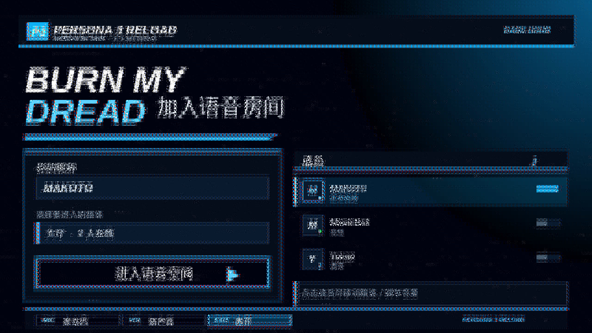

# Persona3 — WebSpeak Skin

女神异闻录 3 Reload 风格：深蓝黑底、电光蓝与冷青强调色，细实线描边、纯平色填充、斜切几何。

> Fan-made theme for [WebSpeak](https://github.com/EchoSixHIYA/WebSpeak-client-for-TeamSpeak). Not affiliated with ATLUS / SEGA.



## Features

- 首页 / 登录页 / 语音页 / `/demo` 全页面覆盖
- 蓝黑底色 + 电光蓝强调，细实线描边与斜切几何
- 角色主视觉背景与头像位素材
- 键盘焦点可见、对比度按 WCAG AA 校准

## Install

### Option A — Skin store

Once this repository is registered in the WebSpeak skin index, administrators can install it
from `/admin/skins` → 皮肤商店 (Skin store).

### Option B — Manual import

1. Download `persona3.wskin` from the [latest release](../../releases/latest).
2. In WebSpeak, open `/admin/skins` and import the `.wskin` file.
3. Enable the skin and (optionally) set it as the instance default.

Visitors pick it from the skin switcher; the host keeps built-in light/dark available at all times.

## Compatibility

| Item | Value |
| --- | --- |
| WebSpeak | `>= 0.2.5` |
| Verified on | v0.2.9 |
| Skin id | `persona3` |
| Version | `2.2.1` |

The stylesheet follows the v0.2.9 sandbox rules: every selector starts with
`:root`, `[data-ws-page…]`, `[data-ws-part…]` or `[data-ws-plugin-part…]`, and the
package never redefines host tokens (`--ws-*` / `--surface-*`).

## Build

```bash
python3 scripts/build.py
```

This packs `skin/` into `persona3.wskin` (a plain ZIP: `manifest.json`, `skin.css`, `assets/*`).

## Layout

```
skin/
  manifest.json   skin metadata (id, name, version, entry, preview)
  skin.css        all styles
  assets/         background, room background, avatar slot, preview, …
scripts/build.py  packaging script (stdlib only)
skin.json         distribution metadata (tag / path / sha256)
persona3.wskin       built package
```

## Customize

* Replace `skin/assets/bg.jpg` (home hero) and `bg-room.jpg` (voice page) with your own art.
* `avatar-slot.png` is the circular avatar slot used on the join card.
* Colours live in the `:root` block at the top of `skin/skin.css` — every rule reads from those variables.
* Rebuild and re-import after editing.

## Credits

* Theme CSS, build script and packaging: Jh_Harry.
* Character artwork and backgrounds: fan-made, based on the Persona series — © ATLUS / SEGA.
* Built for [WebSpeak](https://github.com/EchoSixHIYA/WebSpeak-client-for-TeamSpeak) by EchoSixHIYA.

## License

Source code: MIT. Artwork under `skin/assets/` is **not** MIT-licensed — see [LICENSE](LICENSE)
for the full exception. Non-commercial fan use only.

## Changelog

- **2.2.1** — 适配 WebSpeak v0.2.9：修复品牌字色被子元素规则压制的问题
- **2.2.0** — 以 Persona4 的工程质量重构；补齐 /demo 与语音页覆盖、圆角与对比度修正
